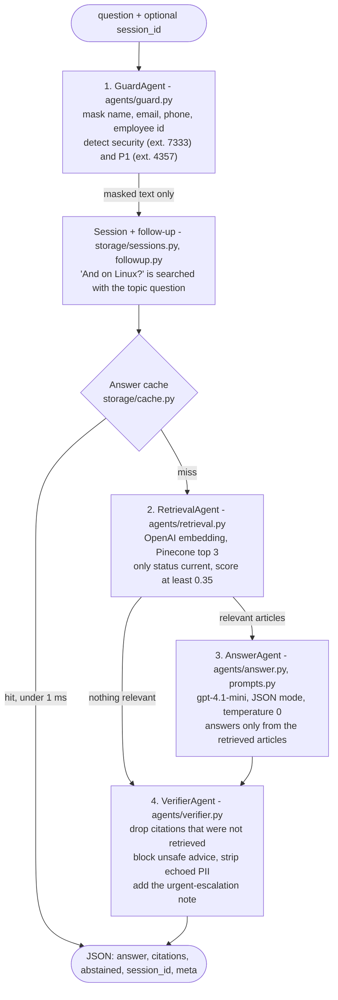

# Vectra IT Assistant: RAG over an IT knowledge base

An IT help-desk assistant for Vectra Logistics' 3,000 staff. It answers **only** from 9 KB articles, cites the
articles it used, and **abstains with a "raise a ticket" message** when the KB doesn't cover the question.
It is built with OpenAI and Pinecone.

```python
from vectra import answer
answer("What is the resolution target for a P2 ticket?")
# {"answer": "The resolution target for a P2 ticket is 8 hours. The first response time is 1 hour.",
#  "citations": ["KB-003"], "abstained": false}
```

**Live demo:** *(link shared privately)* · **Full write-up:** [docs/DOCUMENTATION.md](docs/DOCUMENTATION.md)

## The pipeline

Four agents, each in its own file. Only one of them calls the LLM.



Guard and Verifier are plain code on purpose: they are instant, deterministic and testable, and a prompt
injection can't talk them out of their rules.

## Repository layout: one file, one job

```
├── app.py                        hosting entry point (exposes the FastAPI app)
├── docs/
│   ├── DOCUMENTATION.md          the assessment write-up: ingestion, metrics, what still fails, go-live plan
│   └── kb/KB-*.md                the 9 KB articles (input data)
└── code/
    ├── main.py                   CLI: ingest | ask | chat | eval | serve | test
    ├── web/index.html            web UI: question tray, chat, raw JSON view, session history
    ├── kb_manifest.json          what was ingested / skipped + kb_version hash
    ├── reports/                  latest eval report (markdown + JSON)
    ├── vectra/
    │   ├── config.py             settings from .env
    │   ├── knowledge_base.py     parse articles, decide what's safe to ingest (skips deprecated + prompt injection)
    │   ├── ingest.py             embed + upsert to Pinecone, one vector per article
    │   ├── privacy.py            PII masking and scrubbing
    │   ├── safety.py             escalation triggers, never-give advice, fallback messages
    │   ├── agents/
    │   │   ├── guard.py          1 · mask + detect urgency
    │   │   ├── retrieval.py      2 · embed + vector search
    │   │   ├── prompts.py        system prompt + message builder
    │   │   ├── answer.py         3 · the LLM call (JSON draft)
    │   │   └── verifier.py       4 · check the draft against the retrieved articles
    │   ├── followup.py           detect follow-ups, build the search query
    │   ├── storage/
    │   │   ├── sessions.py       in-memory sessions (sliding TTL, bounded, LRU)
    │   │   ├── cache.py          in-memory answer cache (TTL + LRU)
    │   │   └── redis_store.py    same two in Redis, for multi-instance / serverless
    │   ├── request_log.py        JSON-lines request log (masked text only)
    │   ├── pipeline.py           Assistant: runs the agents in order · answer()
    │   ├── api.py                FastAPI: /answer, /sessions, /health, web UI
    │   └── evaluation/
    │       ├── cases.py          the brief's 5 samples + 9 tricky cases + a 2-turn session
    │       ├── scoring.py        per-metric scoring and summaries
    │       ├── report.py         writes reports/
    │       └── runner.py         runs the suite cold + warm per model
    └── tests/                    22 offline tests (fakes for OpenAI, Pinecone, Redis)
```

## Results

Live eval: 16 questions, each run cold and then warm from the cache.

| model | right article retrieved | correct abstain | correct citation | expected content | nothing unsafe | p50 |
|---|---|---|---|---|---|---|
| **gpt-4.1-mini** | 12/12 | 14/14 | 14/14 | 11/11 | 16/16 | 1.8 s (cache: < 1 ms) |
| gpt-4o-mini | 12/12 | 14/14 | 14/14 | 10/11 | 16/16 | 1.8 s |

The checks cover:
- The deprecated VPN article (KB-002) and the prompt-injected "community tips" (KB-099) are never ingested or cited.
- Parking, canteen and "turn off Defender" questions abstain **without an LLM call**.
- Phishing gets SecOps ext. 7333, and a stopped warehouse gets the P1 desk ext. 4357.
- Personal data in a question never reaches OpenAI, the logs or the reply.

## Run it

```bash
pip install -r requirements.txt uvicorn pytest
mkdir local && cp .env.example local/.env   # add OPENAI_API_KEY and PINECONE_API_KEY
cd code
python main.py test                # 22 offline tests, no API calls
python main.py ingest --dry-run    # which articles go in and why
python main.py ingest              # embed + upsert to Pinecone
python main.py ask "My account got locked. How long until it unlocks?"
python main.py serve               # web UI at http://localhost:8000, API docs at /docs
python main.py eval                # scored run -> reports/
```

**Hosting:** the app runs serverless (FastAPI behind `app.py`). Sessions and the answer cache live in Redis
there, because serverless instances don't share memory. Keys are environment variables; no secret is in this repo.
